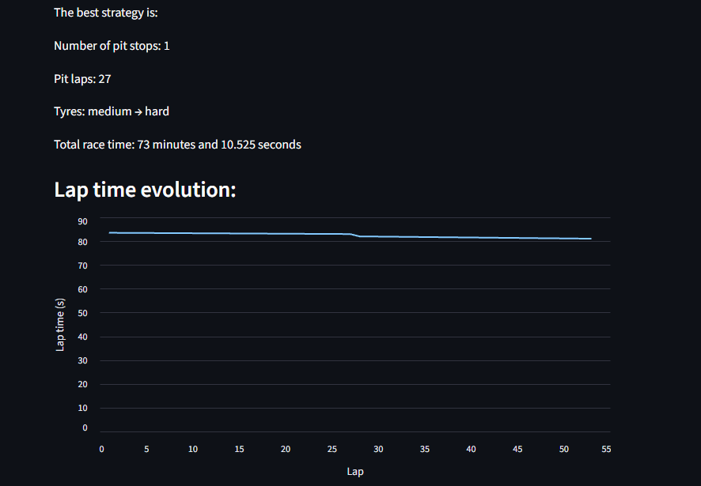

# F1 STRATEGY PREDICTOR


## DESCRIPTION

This is my first engineering related project, F1 Strategy Predictor. The project's purpose is, as it's name suggests, to give anyone a simple tool to predict the strategy used in an F1 race in a simplified manner. It aims to give the average fan a simplified insight into the complexity of a race strategy in formula 1. Its main purpose, however, was to give me, the creator, a first experience in the world of F1 engineering, although a relatively simple one.

## FEATURES

F1 Strategy Predictor's main feature is making a prediction of the strategy for a race specified by the user. The program is also able to calculate the total amount of fuel needed for the race, given the user's input of fuel used per lap and the number of laps in the race.

More importantly, the program is able to use data from a previous race, obtained through the FastF1 library, as a reference for the race in which the prediction will be made. It calculates the fastest possible strategy and returns information about which tyre compounds to use, how many pit stops to make and when to pit, as well as the total race time. The program also produces a plot showing the evolution of lap time throughout the race.

This project also contains unit tests to automatically test some of its functions.

## HOW IT WORKS

The program starts by importing all the required modules and functions. Through the functions `get_laptime` and `convert_laptime`, the program obtains the lap-time data required for the strategy calculation. The `convert` functions exist mainly to make the code easier to test.

Then, through the functions `get_nlaps` and `convert_nlaps`, the program obtains the number of laps of the race being studied.

After that, the function `get_fuel` performs the first calculation. Using the fuel consumption per lap entered by the user, it calculates the total amount of fuel needed for the entire race.

Next, the function `get_datarace` obtains, through user input, the information needed to determine which race the model should use as a reference. It then accesses the corresponding data through the FastF1 library.

Following this, the function `get_laptime_evolution` uses linear regression to calculate the average lap-time evolution of the selected race. It obtains two coefficients: `tyre_loss`, representing the time lost due to tyre degradation, and `fuel_effect`, time gained due to the car getting lighter as it's fuel is burned away. Both these coefficients are approximations which may be innacurate for reasons explained below.

Finally, the function `get_strat`, using the data obtained above, calculates all possible strategies, up to 3 pitstops, considering all different combinations of compounds, pitstop laps and identifies the fastest one by calculating the total race time for each one of them. It returns the number of stops, the compounds used, and the total race time. All this information is then presented to the user through the `results` function, together with a plot of lap time as a function of lap number.

All these functions are called by `main`.

## MODEL

The lap time is modelled as:

$$
t_{lap} = t_{base} +
k_{tyre}(TyreAge - 1) +
k_{fuel}(LapNumber - 1)
$$

where:

- $t_{base}$ is the baseline lap time for the selected compound;
- $k_{tyre}$ represents the estimated tyre degradation;
- $k_{fuel}$ represents the estimated lap-time improvement associated with fuel burn;
- $TyreAge$ is the number of laps completed on the current set of tyres.

## STRUCTURE

```text
F1_Strategy_Predictor/
├── f1_stratV1.py
├── f1_strat_appV1.py
├── requirements.txt
├── README.md
├── images/
│   └── preview_f1_strat.png
└── .gitignore
```
`f1_stratV1` contains the main code and all its functions. `f1_strat_appV1.py` contains the main code in a streamlit version providing a more user-friendly interface. `requirements.txt` contains the libraries required to run the project. `preview_f1_strat` is a screenshot of the code's results.

## REQUIREMENTS AND USAGE

The project requires **Python 3** and several external libraries, including FastF1, NumPy, Pandas, scikit-learn, Streamlit, Matplotlib, and pytest.

First, clone the repository and navigate to the project directory:

```bash
git clone https://github.com/eduardogomescamacho/F1_Strategy_Predictor.git
cd F1_Strategy_Predictor
```

Then, install the required dependencies:

```bash
pip install -r requirements.txt
```

The program can be run from the terminal using:

```bash
python f1_stratV1.py
```

Alternatively, the Streamlit version can be launched with:

```bash
python -m streamlit run f1_strat_appV1.py
```

The Streamlit version provides a more user-friendly interface for entering the required race information and viewing the predicted strategy.

The project also includes unit tests using `pytest`. To run them, use:

```bash
pytest
```

When running the program, the user is prompted to provide the necessary race information. The program then retrieves the selected reference-race data through FastF1, analyses the lap-time evolution, evaluates the possible strategies, and displays the predicted fastest strategy and its estimated total race time.

## LIMITATIONS AND FUTURE IMPROVEMENTS

This project allowed me to learn many programming and motorsport-engineering-related concepts. Although I recognise that the model is not perfect, the program does not currently take into account many important factors when it comes to race strategy, such as temperature, Safety Cars, and traffic. This leads to some innacurate results when compared to reality, which are to be expected.

Future versions may incorporate these variables and others. I also have the ambition to create a racing-line and lap-time simulator, which could eventually be integrated into this project.

## PREVIEW


## ABOUT THE AUTHOR

My name is Eduardo Camacho, a Portuguese high-school student with the dream of becoming an F1 engineer. This project was my first dive into the world of motorsport engineering, and I am proud of what I have achieved with this relatively simple project.

**GitHub:** `eduardogomescamacho`


